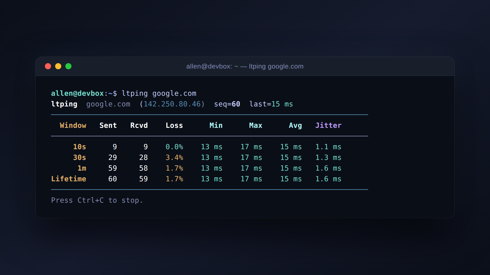

# ltping — Long-Term Ping Monitor

A beautiful, real-time CLI tool for monitoring network latency over configurable time windows. Track ping statistics with live updates, color-coded metrics, and sliding window analytics.



## Features

- **📊 Sliding Window Statistics** — Track metrics across multiple configurable time periods (10s, 1m, 5m, 1h, etc.)
- **⏱️ Lifetime Analytics** — Cumulative session metrics (Sent, Rcvd, Loss, Min/Max/Avg RTT, Jitter) right in the table
- **🌐 Network Interface Selection** — Specify the outgoing network interface name or source IP with `-I` / `--interface`
- **🎨 Live Color-Coded Display** — Green for healthy, yellow for moderate, red for critical latency/loss
- **⚡ Real-Time Updates** — In-place refresh shows evolving stats as old pings age out of each window
- **🔒 No Root / Administrator Required** — Uses unprivileged ICMP sockets on Linux and native IP Helper API (`iphlpapi.dll`) on Windows 10/11
- **📈 Comprehensive Metrics** — Min/Max/Avg RTT, packet loss percentage, and network jitter
- **⌨️ Simple & Intuitive** — Clean interface, sensible defaults, easy to customize

## Quick Start

```bash
# Clone the repository
git clone https://github.com/yourusername/ltping.git
cd ltping

# Make it executable
chmod +x ltping.py

# Run with default settings (10s / 30s / 60s windows)
python3 ltping.py google.com
```

## Installation

### Requirements

- Python 3.10 or newer
- Linux (kernel 2.6.39+) or Windows 10 / 11
- Standard user permissions (no root or Administrator elevation required)

### System Setup

**Linux:**
Most modern Linux distributions allow unprivileged ping sockets by default. If you see a "ping_group_range" error on first run, fix it with:

```bash
sudo sysctl -w net.ipv4.ping_group_range='0 2147483647'
```

To make this permanent across reboots:

```bash
echo 'net.ipv4.ping_group_range = 0 2147483647' | sudo tee -a /etc/sysctl.conf
sudo sysctl -p
```

**Windows:**
Zero setup required! Windows uses the native Win32 IP Helper API (`iphlpapi.dll`), which works out-of-the-box for standard unprivileged users in Command Prompt, PowerShell, and Windows Terminal.

## Usage

### Basic Examples

```bash
# Default: monitor with 10s, 30s, and 60s windows
python3 ltping.py google.com

# Ping an IP address
python3 ltping.py 8.8.8.8

# Ping via a specific network interface
python3 ltping.py 8.8.8.8 -I eth0

# Ping from a specific source IP address
python3 ltping.py 8.8.8.8 -I 192.168.1.10

# Custom time windows
python3 ltping.py example.com -w 5s 15s 60s 5m

# Fast ping interval (500ms between pings)
python3 ltping.py 1.1.1.1 -i 0.5

# Long-term monitoring with multiple windows
python3 ltping.py example.com -w 10s 1m 5m 30m 1h
```

### Command-Line Options

```
ltping [-h] [-w WINDOWS [WINDOWS ...]] [-i INTERVAL] [-t TIMEOUT]
              [-I INTERFACE] [--no-color]
              target

Positional arguments:
  target                Hostname or IP address to ping

Options:
  -h, --help            Show help message and exit
  -w, --windows         Time windows (e.g. 10s 30s 60s 5m 1h)
                        Default: 10s 30s 60s
  -i, --interval        Seconds between pings (default: 1.0)
  -t, --timeout         Seconds to wait for each reply (default: 2.0)
  -I, --interface       Source network interface name or IP address to ping from
                        (run `ltping -I` to list available interfaces)
  --no-color            Disable colored output
```

### Window Specifications

Time windows can be specified in seconds (`s`), minutes (`m`), or hours (`h`):

- `10s` — 10 seconds
- `5m` — 5 minutes (300 seconds)
- `1h` — 1 hour (3600 seconds)
- `30` — Plain numbers are treated as seconds

## Output Format

```
ltping  google.com  (142.250.80.46)  seq=42  last=15.3 ms
────────────────────────────────────────────────────────────────────────
  Window   Sent   Rcvd    Loss      Min      Max      Avg   Jitter
────────────────────────────────────────────────────────────────────────
     10s     10     10    0.0%    12 ms    18 ms    15 ms    2.1 ms
     30s     30     30    0.0%    12 ms    20 ms    15 ms    2.3 ms
     60s     60     59    1.7%    12 ms    25 ms    16 ms    3.1 ms
Lifetime     60     59    1.7%    12 ms    25 ms    16 ms    3.1 ms
────────────────────────────────────────────────────────────────────────
Press Ctrl+C to stop.
```

### Metrics Explained

- **Window** — Time period for rolling statistics (e.g. `10s`, `30s`, `1m`) or **`Lifetime`** for full session metrics
- **Sent** — Total pings sent in this window (or across the entire session for Lifetime)
- **Rcvd** — Pings that received a reply
- **Loss** — Packet loss percentage (color-coded: green = 0%, yellow < 10%, red ≥ 10%)
- **Min/Max/Avg** — Round-trip time statistics in milliseconds
- **Jitter** — Average variation between consecutive RTTs (lower is better)

### Color Coding

**Packet Loss:**
- 🟢 Green: 0% loss
- 🟡 Yellow: < 10% loss
- 🟠 Orange: < 50% loss
- 🔴 Red: ≥ 50% loss

**Latency (RTT):**
- 🟢 Bright Green: < 20ms (excellent)
- 🔵 Cyan: 20-100ms (good)
- 🟡 Yellow: 100-300ms (moderate)
- 🔴 Red: > 300ms (high)

**Jitter:**
- 🟢 Green: Low variance (< 20% of average RTT)
- 🟡 Yellow: Moderate (20-50% of average)
- 🔴 Red: High variance (> 50% of average)

## Use Cases

### Network Troubleshooting

Monitor intermittent connectivity issues over extended periods:

```bash
python3 ltping.py gateway.local -w 1m 5m 15m 1h
```

### ISP Performance Monitoring

Track your internet connection quality throughout the day:

```bash
python3 ltping.py 8.8.8.8 -w 5m 30m 1h 6h -i 2
```

### Application Latency Testing

Measure response time to a remote service with high-frequency pings:

```bash
python3 ltping.py api.example.com -i 0.2 -w 10s 30s 60s
```

### VPN Performance Analysis

Compare latency before and after VPN connection:

```bash
python3 ltping.py cloudflare.com -w 30s 2m 5m
```

### Multi-Interface & Route Testing

Monitor connectivity and latency specifically through a designated network adapter, backup connection, or VPN interface:

```bash
# List available network interfaces
python3 ltping.py -I

# Ping through primary network interface
python3 ltping.py 8.8.8.8 -I eth0

# Ping through VPN or secondary interface
python3 ltping.py 8.8.8.8 -I tun0

# Ping using a specific source IP address
python3 ltping.py 8.8.8.8 -I 192.168.1.10
```

> [!TIP]
> If you omit the interface argument (`ltping -I`) or specify an invalid interface name/IP, `ltping` will automatically display a list of all available network interfaces on your system.

## How It Works

**Sliding Windows:** Each time window maintains a queue of recent ping results. As new pings arrive, old ones beyond the window duration are automatically dropped. This gives you real-time insight into recent network behavior.

**Lifetime Metrics:** A session-wide tracker records all pings, displaying cumulative sent/received counts, loss percentage, min/max/average latency, and jitter directly in the bottom row of the table.

**Unprivileged ICMP:** On Linux, uses `SOCK_DGRAM` with `IPPROTO_ICMP` (the kernel's unprivileged ping socket API). On Windows, uses the native Win32 IP Helper API (`iphlpapi.dll` with `IcmpSendEcho` / `IcmpSendEcho2Ex`). Neither platform requires root or Administrator privileges.

**Jitter Calculation:** Computed as the average of absolute differences between consecutive RTTs within each window. This helps identify network instability beyond simple packet loss.

## Troubleshooting

### "Cannot open ICMP ping socket" error

Your kernel's `ping_group_range` is restricted. Fix with:

```bash
sudo sysctl -w net.ipv4.ping_group_range='0 2147483647'
```

Or run with sudo as a one-time workaround:

```bash
sudo python3 ltping.py example.com
```

### No colors in output

If you're piping output or using a non-TTY terminal, colors are automatically disabled. You can force disable with `--no-color`:

```bash
python3 ltping.py example.com --no-color > log.txt
```

### High CPU usage

By default, ltping pings once per second. If you've set a very short interval (e.g., `-i 0.01`), it may consume more CPU. For most monitoring scenarios, 0.2-1.0 second intervals are sufficient.

## Technical Details

- **Language:** Python 3.10+
- **Dependencies:** Standard library only (no pip packages required)
- **Protocol:** ICMP Echo Request/Reply (RFC 792)
- **Protocols & APIs:** Linux unprivileged ICMP sockets (`AF_INET`, `SOCK_DGRAM`, `IPPROTO_ICMP`) / Windows IP Helper API (`iphlpapi.dll`)
- **Platform:** Linux (kernel 2.6.39+) and Windows (10 / 11)

## Limitations

- **IPv4 only** — IPv6 support is not currently implemented
- **Platform support** — Linux and Windows 10/11 are supported natively without elevation (macOS is not currently supported without root)
- **Single target** — Monitors one host at a time (run multiple instances for parallel monitoring)

## Contributing

Contributions are welcome! Please feel free to submit a Pull Request. For major changes, please open an issue first to discuss what you would like to change.

## License

MIT License — see LICENSE file for details.

## Acknowledgments

- Inspired by traditional `ping` and network monitoring tools
- Built with a focus on real-time visualization and user experience

## See Also

- [`ping`](https://linux.die.net/man/8/ping) — The original ICMP echo utility
- [`mtr`](https://www.bitwizard.nl/mtr/) — Network diagnostic tool combining ping and traceroute
- [`iperf`](https://iperf.fr/) — Network bandwidth measurement tool

---

**Made with ❤️ for network engineers, sysadmins, and anyone who needs to know if their internet is _actually_ working.**